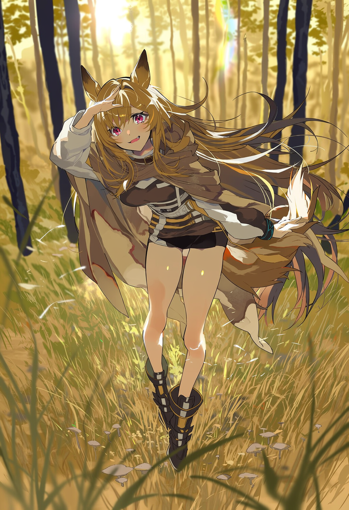

中文 | [English](README_EN.md)

# anime-prompt-writer

一个写二次元生图提示词的 AI skill：**角色、场景、姿态三行分开写**——角色行只负责触发角色，场景行只负责背景/光线/镜头，姿态行只负责动作表情，互不串味。

## 为什么这么写

生图提示词最常见的翻车，是把角色描述、情绪、背景、光线全堆在一坨里，模型抓不住重点。这个 skill 把三块拆开：

- **角色行**：官方角色 tag + 一眼能认出的辨识点，25–30 个词就够，命中优先于细节。
- **场景行**：背景、光线、镜头分开写；背景元素要写「怎么消失」（密度→颜色→对比依次衰减），而不是一句 smooth transition。
- **姿态行**：只写动作与可见的表情肌肉，强调不对称，两只手各有事做。

里面的高频词和次数（如 `cel shading` 178 次、50mm 焦段 74 次、白棚背景 31%）都来自作者本人几百次实际生成的统计，不是抄来的模板。风格块库则是从 188 张成图反推的逆光花海风格拆解，含光线词的实测效果分档。

## 示例



上面这张图的完整提示词（按本 skill 的结构分行标注，原文照录）：

```
【光线头】detailed lighting, dappled sunlight, sunlight, light particles, blurry foreground, lens flare, backlit rim light, strong bloom, anamorphic rainbow streak, dust motes and floating pollen, heavy bokeh, high key

【角色行】masterpiece, best quality, ceobe (arknights), arknights, 1girl, solo, dog girl, dog ears, dog tail, fang, red eyes, hair between eyes, brown hair, very long hair, large breasts, loose brown travelling cloak, hood down, black shorts, long sleeves, bare legs, worn boots

【背景行】a wild forest clearing at golden hour, tall dry grass and scattered wild mushrooms in the foreground, the treeline dissolving into warm haze layer by layer: the nearest trunks stay dark and detailed, the next row loses its leaf detail into soft olive silhouettes, then the far treeline washes out to pale gold and dissolves before it reaches the sky, no visible horizon line, dust and seed fluff drifting in the air

【光线行】strong warm backlight from the low sun behind her, gold rim on her hair, ears and tail, hard key from the upper left throwing long shadows through the grass, soft bounce fill off the dry ground, subsurface scattering, strong bloom around the sun, floating seeds and light particles catching the light, high key with warm deep shadows

【镜头行】full body, centered composition, slight low angle, 50mm, full figure uncropped

【姿态行】standing in the tall grass, one hand shading her eyes, ears perked up, tail raised, leaning slightly forward, fang showing in a grin, looking at viewer

【画风尾】cel shading, thin lineart, painterly rendering, high clarity, low noise, very aesthetic, absurdres, detailed lighting
```

看点：背景行里树林是「一层层溶进雾里」的过程写法（近景深色细节→中景剪影→远景 pale gold 消失），不是一句 blurry background；姿态行里两只手、耳朵、尾巴各有动作，没有对称站桩。

注：同一组提示词更换画师串，出图的风格与细节会有明显差异——本例演示的是结构与写法，复现时请按自己的画师串预期效果。


示例 2 的完整提示词：

```
【角色行】masterpiece, best quality, mostima (arknights), arknights, 1girl, solo, blue hair, long hair, hair between eyes, blue eyes, demon horns, black horns, floating halo, black jacket, open jacket, white shirt, long sleeves, detached wings, energy wings, glowing wings

【背景行】deep navy void, a cold cyan nebula confined to the upper quarter, fading by real atmospheric falloff rather than a mask: star density drops first and the clusters break into loose scattered stars, then the nebula desaturates from saturated cyan to pale steel grey, then the last sparks lose contrast one by one and dissolve into drifting haze, no visible horizon, faint concentric rings of pale cyan light spreading outward behind her

【光线行】strong backlight from behind her, cold cyan and ice blue rim tracing her silhouette against the dark, hard key from upper left with cool violet shadow on the right half, soft fill keeping shadow detail on her face, subsurface scattering, strong bloom on the wing edges and the halo, light particles drifting upward, low-key

【镜头行】full body, centered composition, eye level, 50mm, full figure uncropped

【姿态行】standing, weight on her back leg, one hand raised palm up as if holding a stopped moment, head tilted slightly, half-lidded gaze at viewer, lips slightly parted

【画风尾】cel shading, thin lineart, painterly rendering, high clarity, low noise, very aesthetic, absurdres, detailed lighting
```

看点：这张是 SKILL 里「星空/银河」底的标准打法——星云只占上方四分之一，按密度→饱和→对比的顺序溶进雾里；深色底靠冷色轮廓光把人从背景里勾出来（low-key）。和示例 1 的暖色高调正好是一对。

## 文件

- `SKILL.md` —— 规则正文：三行分工、交付习惯、负向块分类、换装处理。
- `references/角色块库.md` —— 已核对官方立绘的角色块（洛琪希、sunna、huohuo、furina、lappland 等），含换装块。
- `references/场景词库.md` —— 按出现次数排序的背景/光线/镜头/负向高频词。
- `references/风格块库.md` —— 逆光花海风格块（光线三件套、过曝三档、六个高频场景块与组合配方）。

## 用法

把本文件夹放进你的 AI 助手 skill 目录即可。之后直接说「给 XX 写一套提示词」「换个姿势」「背景换成星空」，助手会按三行结构给出**完整可粘贴**的版本，迭代时只改该改的那一行。

适用平台：NovelAI / Stable Diffusion 系的 tag 式提示词。

## License

MIT
