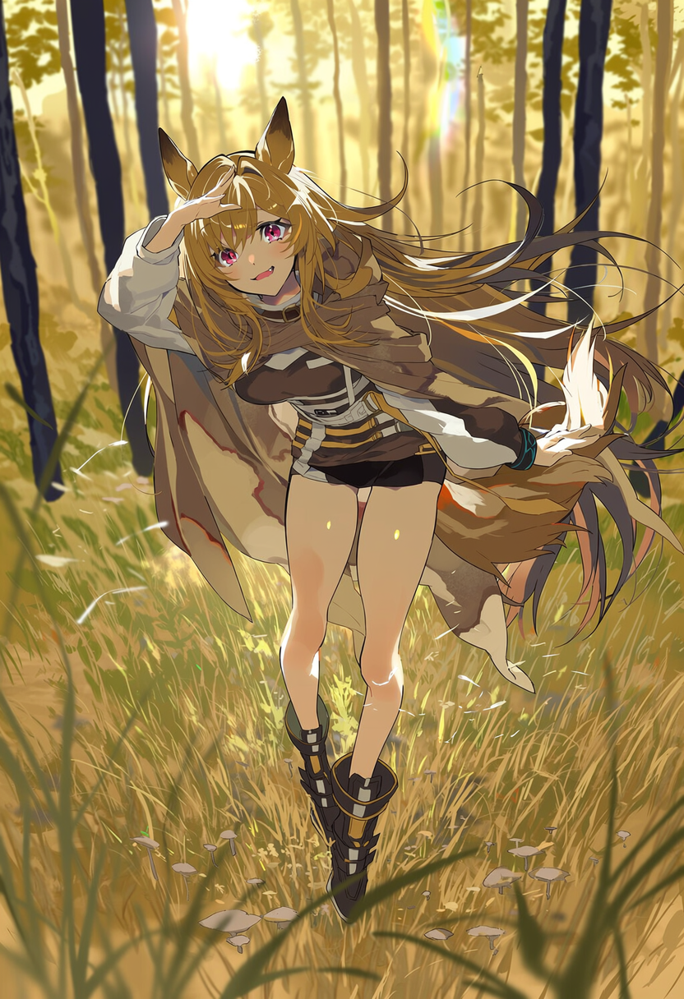

[中文](README.md) | English

# anime-prompt-writer

An AI skill for writing anime image-generation prompts: **character, scene, and pose go on three separate lines** — the character line only triggers the character, the scene line only handles background / lighting / camera, and the pose line only handles action and expression. No cross-contamination.

## Why write it this way

The most common way anime prompts go wrong is piling character description, emotion, background, and lighting into one blob the model can't prioritise. This skill splits the three jobs apart:

- **Character line**: official character tag + the few features someone would recognise at a glance. 25–30 words is enough — hitting the character beats detail.
- **Scene line**: background, lighting, and camera written separately. Background elements must describe *how they disappear* (density → colour → contrast fading in sequence), not a single "smooth transition".
- **Pose line**: only actions and visible expression muscles. Asymmetric by default; both hands should have something to do.

The frequency counts (e.g. `cel shading` ×178, 50mm lens ×74, white-studio backgrounds 31%) come from the author's own statistics over hundreds of real generations — not copied templates. The style library is a backlit flower-field style reverse-engineered from 188 finished images, including lighting words graded by measured effect.

## Example



The full prompt for the image above, labelled by the skill's line structure, verbatim:

```
[lighting head] detailed lighting, dappled sunlight, sunlight, light particles, blurry foreground, lens flare, backlit rim light, strong bloom, anamorphic rainbow streak, dust motes and floating pollen, heavy bokeh, high key

[character] masterpiece, best quality, ceobe (arknights), arknights, 1girl, solo, dog girl, dog ears, dog tail, fang, red eyes, hair between eyes, brown hair, very long hair, large breasts, loose brown travelling cloak, hood down, black shorts, long sleeves, bare legs, worn boots

[background] a wild forest clearing at golden hour, tall dry grass and scattered wild mushrooms in the foreground, the treeline dissolving into warm haze layer by layer: the nearest trunks stay dark and detailed, the next row loses its leaf detail into soft olive silhouettes, then the far treeline washes out to pale gold and dissolves before it reaches the sky, no visible horizon line, dust and seed fluff drifting in the air

[lighting] strong warm backlight from the low sun behind her, gold rim on her hair, ears and tail, hard key from the upper left throwing long shadows through the grass, soft bounce fill off the dry ground, subsurface scattering, strong bloom around the sun, floating seeds and light particles catching the light, high key with warm deep shadows

[camera] full body, centered composition, slight low angle, 50mm, full figure uncropped

[pose] standing in the tall grass, one hand shading her eyes, ears perked up, tail raised, leaning slightly forward, fang showing in a grin, looking at viewer

[style tail] cel shading, thin lineart, painterly rendering, high clarity, low noise, very aesthetic, absurdres, detailed lighting
```

Note the background line: the treeline *dissolves layer by layer* (dark detailed trunks → soft silhouettes → pale gold, gone before the sky) instead of a flat "blurry background"; in the pose line, hands, ears, and tail each have their own action — no symmetric standing-at-attention.

## Files

- `SKILL.md` — the rules: three-line split, delivery habits, negative-prompt categories, outfit changes.
- `references/角色块库.md` — character blocks verified against official art (Roxy, sunna, huohuo, Furina, Lappland, …), with outfit-swap blocks.
- `references/场景词库.md` — background / lighting / camera / negative high-frequency words, sorted by occurrence count.
- `references/风格块库.md` — the backlit flower-field style block (lighting trio, three overexposure grades, six high-frequency scene blocks and combo recipes).

## Usage

Drop this folder into your AI assistant's skill directory. Then just say "write a prompt set for XX", "change the pose", or "make the background a starry sky" — the assistant returns a **complete, paste-ready** version in the three-line structure, and iterations change only the line that needs changing.

Platforms: tag-style prompting for NovelAI / Stable Diffusion family models.

## License

MIT
